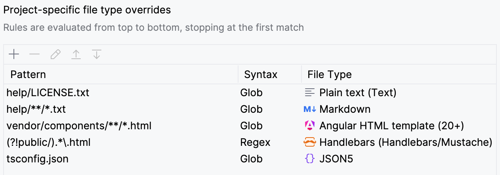
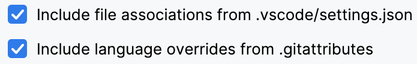
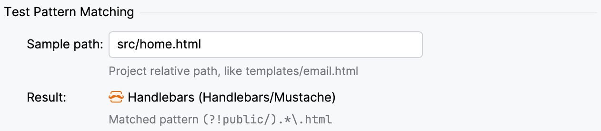
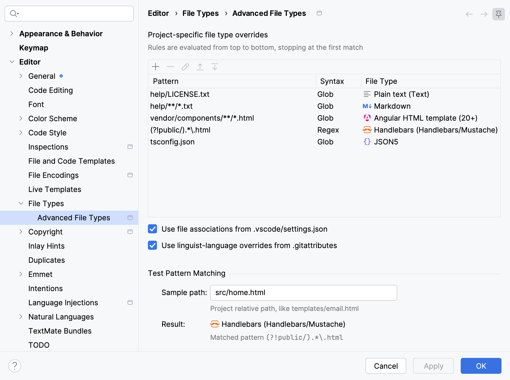
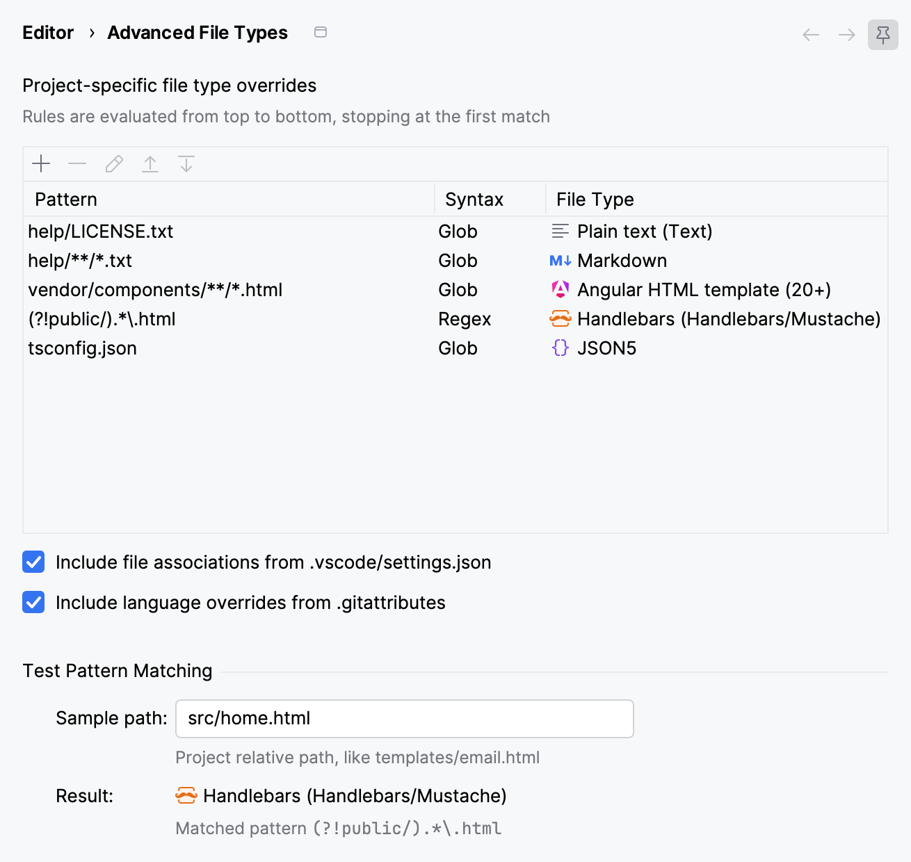

# Advanced File Types plugin for JetBrains IDEs

The **Advanced File Types** plugin adds project-level file type overrides in JetBrains IDEs. It supports globs or regex with full path matching . It can also load file types from VS Code settings and Git `linguist-language` attributes.

Using the plugin, you could…

* Change `*.html` to Handlebars in one project and EJS in another.
* Treat `docs/**/*.txt` as Markdown but other `*.txt` files as plain text.
* Enable JSON5 syntax for all of `config/*.json`.
* Stop reassigning `*.tpl` or `*.conf` every time you switch projects.

## Contents

* [Features](#features)
* [Installation](#installation)
* [Usage](#usage)
  * [Glob patterns](#glob-patterns)
  * [Regular expression patterns](#regular-expression-patterns)
  * [VS Code setttings and .gitattributes linguist-language support](#vs-code-settings-and-gitattributes-linguist-language-support)
  * [Limitations](#limitations)
* [Why this plugin?](#why-this-plugin)
* [Screenshots](#screenshots)
* [Development](#development)
* [License](#license)

## Features
<!--suppress CheckImageSize -->

* **Project-specific file types:** Override the global *File Types* settings in each project.

* **Flexible pattern matching:** Use [globs](#glob-patterns) (including `**`) and [regular expressions](#regular-expression-patterns). Match filenames or full directory paths in priority order.

  <picture>
    <source media="(prefers-color-scheme: dark)" srcset="img/pattern-matching-rules_dark.png" width="631">
    
  </picture>

* **VS Code and .gitattributes support:** Optionally load file type associations from `.vscode/settings.json` and GitHub's `linguist-language` Git attributes.

  <picture>
    <source media="(prefers-color-scheme: dark)" srcset="img/vscode-and-gitattributes_dark.png" width="353">
    
  </picture>

* **Commit and share settings:**
  Project file types are saved in `.idea/advancedFileType.xml`
  and can be checked into source control.

* **Integrated pattern tester:**
    Easily verify rules and imported associations.

  <picture>
    <source media="(prefers-color-scheme: dark)" srcset="img/test-pattern-matching_dark.png" width="631">
    
  </picture>

* **Free and open source**

## Installation

The **Advanced File Types** plugin should work with any JetBrains IDE version 2025.3 and later.

1. Open **Settings | Plugins**
2. Search for **Advanced File Types** in the marketplace
3. Click **Install**

Or download the latest release from the [JetBrains Marketplace](https://plugins.jetbrains.com/plugin/35076-advanced-file-types).

## Usage

Configure file type overrides in **Settings | Editor | File Types | Advanced File Types**.

* Use the `+` button to add a new rule, `-` to remove a rule, and arrow buttons to reorder rules. Select an existing rule and click the pencil button to edit it (or double click it in the list).
* Use the checkboxes to enable or disable VS Code and Git attributes matching. (Both are enabled by default.)
* The **Test Pattern Matching** section can be helpful to verify your rules work as expected.

The plugin applies matching rules in this order, stopping at the first match:

1. Custom patterns from top to bottom
2. `.vscode/settings.json` (if enabled)
3. `.gitattributes` (if enabled)

If none of those match a particular file, the IDE's global rules from **Settings | Editor | File Types** apply.

Project settings are stored in `.idea/advancedFileTypes.xml`. Commit this file to your repo to share it.

### Glob patterns

Glob patterns follow [VS Code's glob syntax][vscode-glob-patterns] and support `*` and `?` filename wildcards, `**` to match zero or more directories, `{txt,html}` alternations, `[0-9.]` character ranges and `[!a-z]` negated ranges.

* Use `/` as the directory separator, even on Windows. (Backslashes in Windows paths are converted to `/` before matching.)
* Glob patterns **without `/`** match a *filename* anywhere in the project. (`*.txt` matches `readme.txt` and `docs/help/faq.txt` but not `docs/intro.txt.bak`.)
* Glob patterns **with `/`** anywhere match a *full path* starting at project root. (`docs/*.txt` matches `docs/intro.txt` but not `readme.txt` or `public/docs/faq.txt`. `/*.txt` or `./*.txt` matches `readme.txt` in the root directory but not `docs/intro.txt`.) Use `**` to match multiple path segments.
* Matching is **case-insensitive** on all operating systems.
* You cannot use backslash to escape characters in glob patterns. Use the `[...]` syntax instead: `[[]` to match a literal `[`, `[}]` to match `}`, etc.

[vscode-glob-patterns]: https://code.visualstudio.com/docs/editor/glob-patterns

### Regular expression patterns

Regex patterns are always evaluated against the *entire project-relative path,* with no leading `/` and with directory separators normalized to `/` on all platforms. A full string match is required (implicit `^...$` anchors).

Note that regex `.*` matches *any* characters, including `/` directory separators. Use `[^/]*` to match a single pathname component.

Negative lookahead is supported. For example, `(?<!public/).*\.html` will match all `.html` files except those under `public/`.

Regex syntax follows Java's [`java.util.regex.Pattern`][java-regex] with case-insensitive matching. See [JetBrains IntelliJ IDEA Regular Expressions Guide][jetbrains-regex] for details.

[java-regex]: https://docs.oracle.com/en/java/javase/21/docs/api/java.base/java/util/regex/Pattern.html
[jetbrains-regex]: https://www.jetbrains.com/help/idea/regular-expressions.html

### VS Code settings and .gitattributes linguist-language support

VS Code file type associations are read from the `files.associations` section in `.vscode/settings.json`. (Patterns are treated as case-insensitive on all platforms, which doesn't strictly match VS Code's behavior. The plugin only checks the root `.vscode/settings.json` file. Multi-root workspaces and user global settings are not currently supported.)

GitHub language IDs are read from `linguist-language` properties in `.gitattributes` files. (This only works in projects that are actually in a git repository with `git` available. The plugin uses a lightweight `git check-attr` process to get accurate attributes.)

In both cases, the plugin tries to map the [VS Code language identifier][vscode-language-id] or [GitHub Linguist ID/alias][linguist-language-id] to a JetBrains IDE file type. If no IDE type can be determined, the plugin will ignore the rule. If you enter one of these paths in **Test Pattern Matching** you'll see "unknown VS Code id" or "unknown Linguist id."

Even when the plugin *can* determine the correct IDE file type, it may require language support that isn't configured in your IDE. In that case the rule will also be ignored and the global *File Types* setting will apply. **Test Pattern Matching** will show that file type with "no IDE support."

The plugin automatically reloads rules whenever the VS Code settings or Git attributes files are changed. (This only watches files inside the project directory. Global Git attributes are respected, but if they change you'll need to clear the checkbox, apply the settings change, and re-enable it to pick up the updates.)

#### Custom language ID mappings

If your project uses custom, proprietary, or newly introduced language identifiers in `.vscode/settings.json` or `.gitattributes` that are not recognized by default, you can define custom language ID mappings that add to or override the plugin's built-in set.

This is an advanced feature meant for unusual situations, and there is no settings UI for it. Editing settings files directly can break things. In `.idea/advancedFileTypes.xml` add a `<customLanguageMappings>` block:

```xml
<component name="AdvancedFileTypeSettings">
  <!-- The <rules> section is managed by the settings UI. Do not edit it. -->
  <rules><!-- ... --></rules>
  <!-- Add this: -->
  <customLanguageMappings>
    <mapping language="my-custom-lang" fileTypeName="HTML" />
    <mapping language="custom-dsl" fileTypeName="PLAIN_TEXT" />
  </customLanguageMappings>
</component>
```

The `language` is the identifier that appears in your VS Code settings or `linguist-language`, and the `fileTypeName` is the IDE file type's exact internal name, which is often different from the name displayed in the IDE. (To figure out the internal name, create a temporary pattern rule with that file type in the settings UI, and then check the `<rules>` section of the settings file to find the `fileTypeName` attribute.)

[vscode-language-id]: https://code.visualstudio.com/docs/languages/identifiers#_known-language-identifiers
[linguist-language-id]: https://github.com/github-linguist/linguist/blob/master/lib/linguist/languages.yml

### Limitations

Advanced File Types overrides do not apply to files located outside the project root folder. This includes:
* Externally attached content roots
* Attached projects in other directories
* Symlinks that lead out of the project directory
* Scratch files

Any files outside the project root folder are handled by the IDE's global file type associations.

## Why this plugin?

Although powerful, JetBrains' standard [**File Types**][file-types-setting] associations don't cover several real-world use cases. The IDE's rules apply globally to all projects, support only filename patterns (not path matching), and can't be ordered by priority. See these YouTrack issues:

* [IDEABKL-6335](https://youtrack.jetbrains.com/issue/IDEABKL-6335): "Assign file types not only globally but project-wide as well"
* [IDEABKL-7096](https://youtrack.jetbrains.com/issue/IDEABKL-7096): "Add ability to 'share' File Type associations as part of project config."
* [IJPL-2316](https://youtrack.jetbrains.com/issue/IJPL-2316): "File type associations: Match file name patterns against the file path or per project"
* [IJPL-3389](https://youtrack.jetbrains.com/issue/IJPL-3389): "File association prioritization for multiple matching patterns"
* [IJPL-39352](https://youtrack.jetbrains.com/issue/IJPL-39352): "Add the possibility to store custom file types in .idea"
* [IJPL-52980](https://youtrack.jetbrains.com/issue/IJPL-52980): "File Type Association should use REGEX not just * and ? for pattern matching"
* [IJPL-52947](https://youtrack.jetbrains.com/issue/IJPL-52947): "Support extending file type settings in project level .idea config"
* [IJPL-258202](https://youtrack.jetbrains.com/issue/IJPL-258202) "File type associations: Honor linguist-language overrides from .gitattributes"

(JetBrains: please feel welcome to adopt, absorb, or otherwise obsolete this plugin!)

[file-types-setting]: https://www.jetbrains.com/help/idea/creating-and-registering-file-types.html#configure-associations-between-filename-patterns-and-file-types

## Screenshots

Here's the whole settings dialog with **Advanced File Types** open:

<picture>
  <source media="(prefers-color-scheme: dark)" srcset="img/settings-dialog_dark.png" width="900">
  
</picture>

And just its settings configuration panel:

<picture>
  <source media="(prefers-color-scheme: dark)" srcset="img/settings-panel_dark.png" width="655">
  
</picture>

## Development

To install an unreleased development build:
* Download `advanced-file-types-<version>.zip` from the latest [Build workflow run][builds] (look for the *Artifacts* section at the end of the run's results)
* Install the plugin zip in your IDE under **Settings | Plugins | ⚙️ | Install plugin from disk** (see JetBrains [managing plugins][install-plugin-from-disk] docs)

You can also download released versions from GitHub's [releases] page and install them the same way.

To build locally:
* Clone the repository
* Run `./gradlew check` to run the tests
* Run `./gradlew buildPlugin` to build the plugin
* In your IDE, use **Settings | Plugins | ⚙️ | Install plugin from disk** and select `build/distributions/advanced-file-types-<version>.zip` from your local build

[builds]: https://github.com/medmunds/advanced-file-types/actions/workflows/build.yml
[releases]: https://github.com/medmunds/advanced-file-types/releases
[install-plugin-from-disk]: https://www.jetbrains.com/help/idea/managing-plugins.html#install_plugin_from_disk

## License

This project is licensed under the [MIT License](LICENSE).

### Third-Party Licenses

This project uses the following third-party software which is bundled in its distribution:

* [json5-java](https://github.com/marhali/json5-java):  [Apache License 2.0](https://github.com/marhali/json5-java/blob/main/LICENSE)
